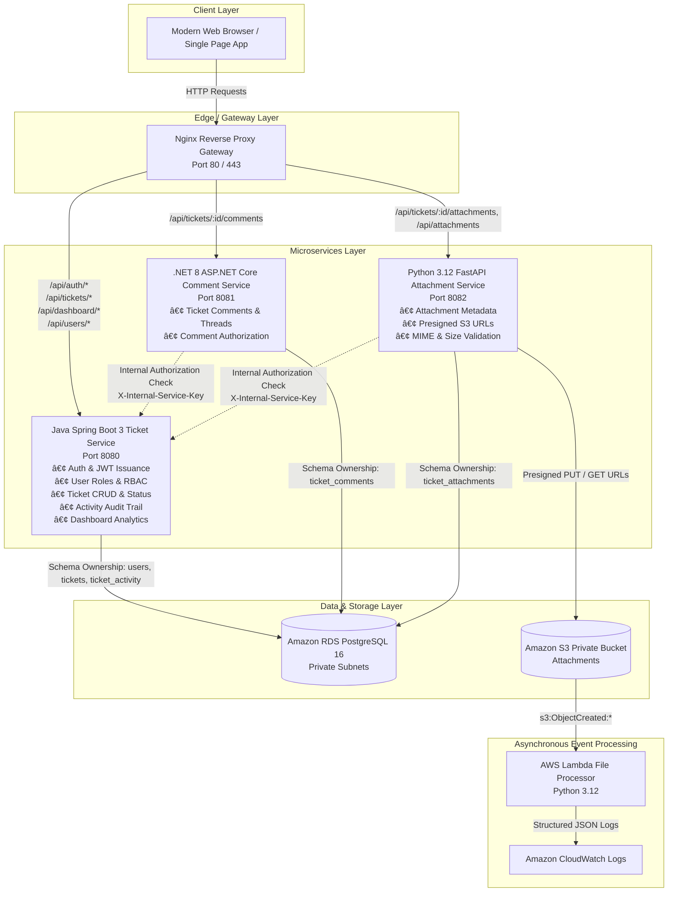
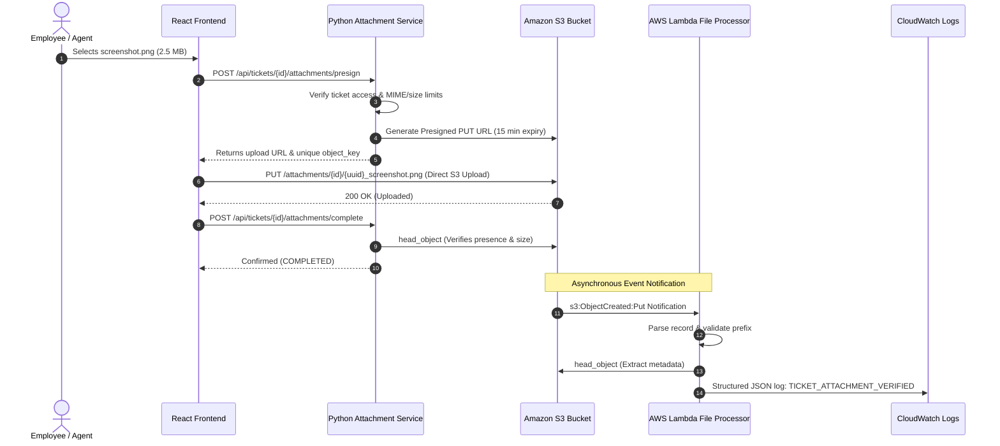

# TicketDesk — System Architecture & Workflow

## 1. System Overview

TicketDesk implements a polyglot microservice architecture orchestrated via Docker Compose and fronted by an Nginx reverse proxy. The architecture separates domain concerns while preserving a unified API origin for the browser client.



---

## 2. Cross-Service Communication & Authorization

### The Problem
A user possessing a valid JWT signed by the system must not automatically be able to read or comment on arbitrary tickets. Employees must only access tickets they authored.

### The Solution: Internal Service Verification
1. When a request reaches the **.NET Comment Service** (`GET/POST /api/tickets/{id}/comments`) or **Python Attachment Service** (`GET/POST /api/tickets/{id}/attachments/*`):
2. The service decodes the JWT bearer token, extracting the `userId` and `role`.
3. If the role is `ADMINISTRATOR` or `SUPPORT_AGENT`, access is granted based on operational scope.
4. If the role is `EMPLOYEE`, the service initiates a secure, synchronous HTTP call to the **Java Ticket Service**:
   ```http
   GET /api/internal/tickets/{ticketId}/verify-access?userId={userId}
   X-Internal-Service-Key: TicketDeskInternalServiceAuthSecret2026!
   ```
5. The Java service checks the canonical ticket record in PostgreSQL and returns:
   ```json
   {
     "ticketId": "44444444-4444-4444-4444-444444444441",
     "canAccess": true,
     "role": "EMPLOYEE",
     "isOwner": true,
     "isAssigned": false,
     "reason": "Access granted"
   }
   ```
6. If `canAccess` is `false`, the microservice returns `HTTP 403 Forbidden`. The browser never passes an untrusted user ID or bypasses the check.

---

## 3. Asynchronous File Processing Flow



