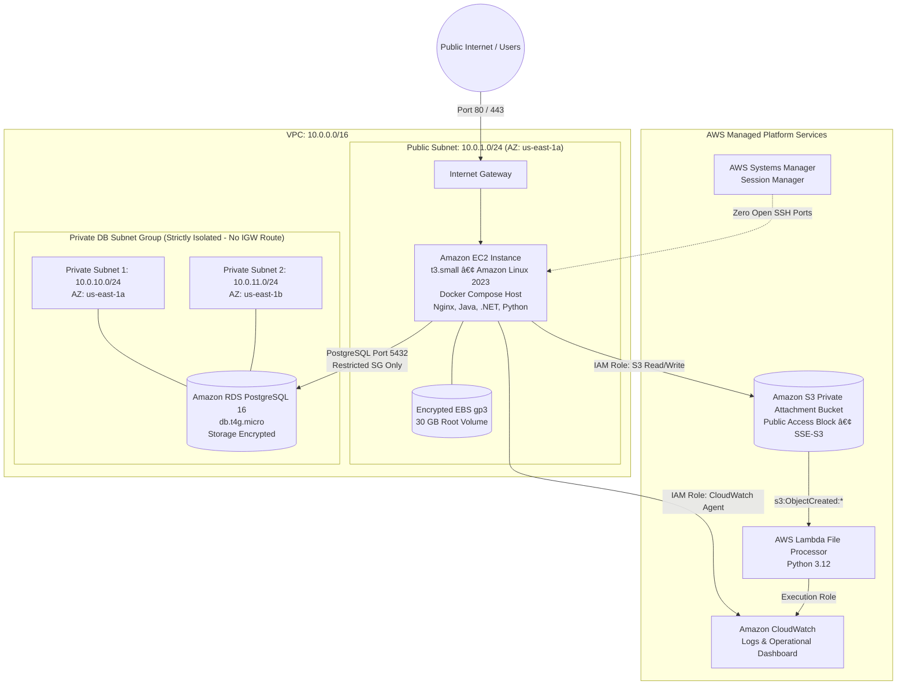

# AWS Cloud Architecture & Infrastructure Design

## 1. Cloud Architecture Overview

The TicketDesk AWS cloud architecture is engineered to satisfy the Enterprise Cloud Engineer Level Proof of Concept requirements with strict adherence to **Cost Optimization**, **Security**, and **Reliability**.

---

## 2. AWS Service Mapping & Rationale

| Service | Configuration | Justification / Engineering Rationale |
|---|---|---|
| **Amazon EC2** | `t3.small`, Amazon Linux 2023, Docker Compose | Host the containerized polyglot microservices in a single, cost-effective instance without introducing complex Kubernetes overhead for a POC. |
| **Amazon RDS** | PostgreSQL 16.3, `db.t4g.micro`, 20GB gp3 | Relational persistence with automated backups, storage encryption, and private subnet isolation. |
| **Amazon S3** | Private Bucket, SSE-S3, Versioning enabled, CORS | Stores uploaded ticket attachments with complete public access blocking; integrates with S3 event notifications. |
| **AWS Lambda** | Python 3.12, 128MB RAM, 30s timeout | Serverless, event-driven validation of S3 file uploads without polling or continuous background workers. |
| **Amazon CloudWatch** | Log Groups (`/ticketdesk/app`, `/aws/lambda/*`), Dashboard | Centralized structured log collection and metrics visualization for CPU, database connections, and Lambda invocations. |
| **AWS IAM** | Least-privilege instance profile and execution roles | EC2 uses IAM instance profiles for S3 and CloudWatch, eliminating permanent AWS credentials from code. |
| **AWS Systems Manager** | SSM Session Manager (`AmazonSSMManagedInstanceCore`) | Secure remote terminal access to EC2 without requiring publicly exposed SSH port 22. |

---

## 3. Cost-Optimization Strategy

1. **No NAT Gateway by Default:**  
   NAT Gateways incur a baseline cost of ~$32/month per gateway plus data transfer charges. By placing the EC2 application instance in the public subnet (with tightly restricted inbound security groups) and placing Amazon RDS in private subnets with no internet route, we eliminate NAT Gateway costs completely while preserving database security.
2. **ARM-Based Database Instance (`db.t4g.micro`):**  
   AWS Graviton2 instances deliver up to 40% better price-performance compared to comparable x86 instances.
3. **Single-AZ Development RDS:**  
   Avoids multi-AZ standby replication costs during the evaluation phase.
4. **Automated Clean Teardown:**  
   The Terraform configuration includes `force_destroy = true` on S3 and `skip_final_snapshot = true` on RDS so `terraform destroy` executes cleanly in one command.

