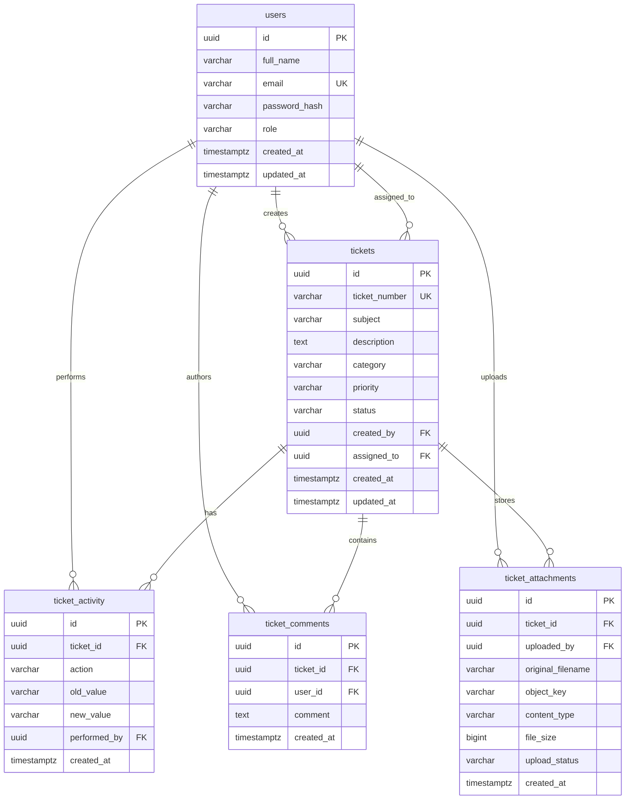

# PostgreSQL Database Schema & Ownership Model

## 1. Database Architecture & Table Ownership

To prevent schema conflicts and enforce domain isolation, each microservice has explicit ownership over specific relational tables within PostgreSQL 16:

| Table Name | Owner Microservice | Primary Key | Description |
|---|---|---|---|
| `users` | **Java Spring Boot** | `UUID` | User accounts, credentials, and roles |
| `tickets` | **Java Spring Boot** | `UUID` | Primary support issue metadata |
| `ticket_activity` | **Java Spring Boot** | `UUID` | Historical workflow audit events |
| `ticket_comments` | **.NET 8 ASP.NET Core** | `UUID` | Ticket discussion thread and comments |
| `ticket_attachments` | **Python 3.12 FastAPI** | `UUID` | S3 object keys and file metadata |

---

## 2. Entity-Relationship Diagram (ERD)

---

## 3. Migration Strategy (Flyway)

Flyway manages schema versioning in `backend/java-ticket-service/src/main/resources/db/migration`:
- **`V1__init_schema.sql`:** Creates all base tables with indexes and constraints.
- Automatic migration executes safely at container startup before application traffic is accepted.
- In production, Flyway validates schema hashes and prevents destructive manual alterations.
